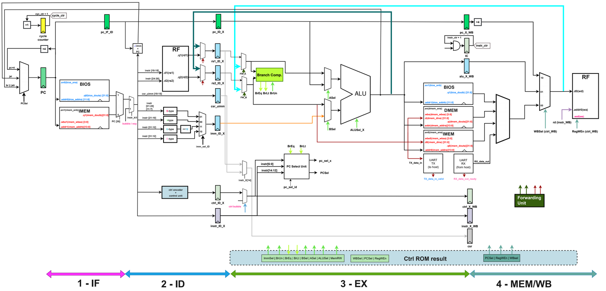

# Four-Stage RISC-V pipelined design
 

- Design features: fully bypassed, early branch target resolution
- RTL: Verilog (IEEE-1364 2001/2005 style)
- Target platform: Xilinx Zynq 7020 on PYNQ Z1
- Verification: directed and ad-hoc co-simulation with reference models
- I/O: UART tx/rx, syncronizer (CDC) + debouncer (pressing buttons on the board is an exciting activity)
- BIOS, asm and C test suites, CSRs
 

Authors: Alex Volkov, Anastasia ~~Simonova~~ Chernikova

