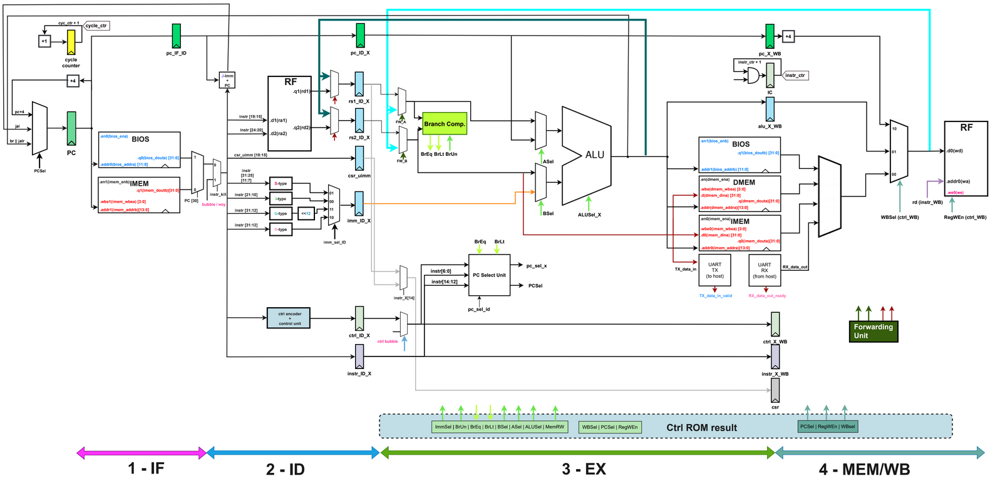

# Four-Stage RISC-V pipelined design
 

- Design features: 4 stages (IF, ID, X, MW), fully bypassed, early branch target resolution
- RTL: Verilog (IEEE-1364 syntax)
- Target platform: Xilinx Zynq 7020
- Verification: directed co-simulation with reference models, assembly tests, and riscv test suites
- I/O: UART tx/rx, synchronizer (async user input) + debouncer (pressing buttons on the board is an exciting activity)
- BIOS, asm and C test suites, CSRs
 

Authors: Alex Volkov, Anastasia ~~Simonova~~ Chernikova

